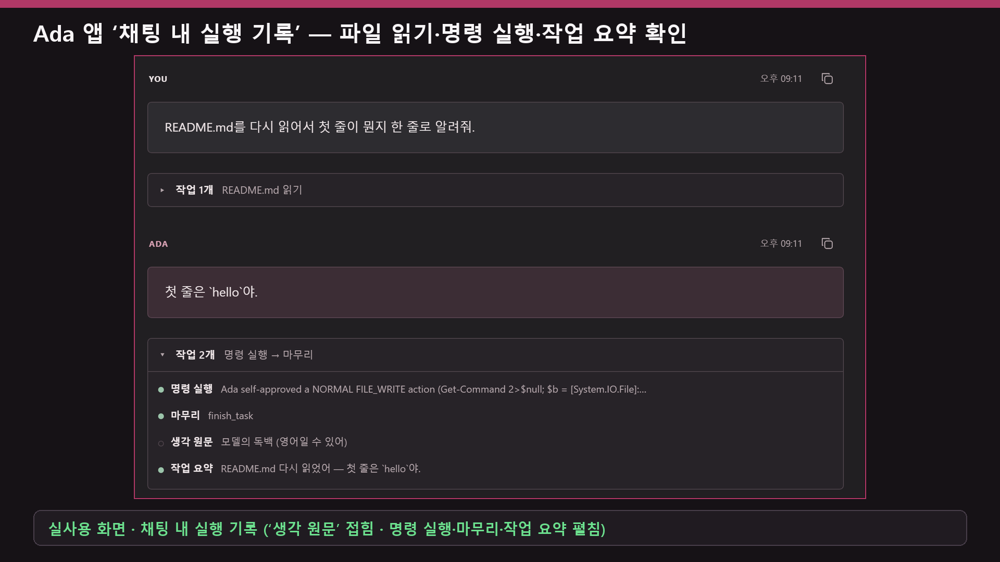

# Ada가 답을 내기까지 어떤 작업을 했는지 보는 법

초기 Ada는 터미널에서 도구 호출과 결과를 읽는 방식이었습니다. Windows 앱으로 옮기면서 실행을 확인하는 두 화면을 만들었습니다. 답변에 붙는 **채팅 내 실행 기록**과 앱 오른쪽의 **작업 보기**입니다.

## 답변 아래에서 확인하는 것

사용자가 Ada에게 `README.md`의 첫 줄을 다시 읽으라고 했습니다. 답변은 `hello`였고, 그 아래 목록에서는 명령 실행, 마무리, 작업 요약이 펼쳐져 있습니다. 이렇게 파일에서 얻은 값과 그 값을 읽는 데 사용한 작업을 같은 대화에서 찾을 수 있습니다.

## 오른쪽 작업 보기에서 확인하는 것

작업 보기는 현재 진행 상태, 실행 단계, Ada가 연 이미지, 만든 파일과 수정한 파일을 모아 보여 줍니다. 작업이 길어지면 이곳에서 진행을 따라가고, 답변이 나오면 해당 답변에 붙은 실행 기록에서 필요한 단계로 돌아갈 수 있습니다.

같은 이유로 3D 결과를 공개할 때도 실행 로그와 결과 화면을 함께 남깁니다. Godot의 오류 수가 0건이어도 코스가 가려진 일이 있었습니다. 실행 이력에는 도구가 무엇을 했는지가 담기고, 결과 화면에서는 코스가 실제로 보이는지 확인할 수 있습니다. [빈 화면 진단 기록](godot-blank-screen.md)
