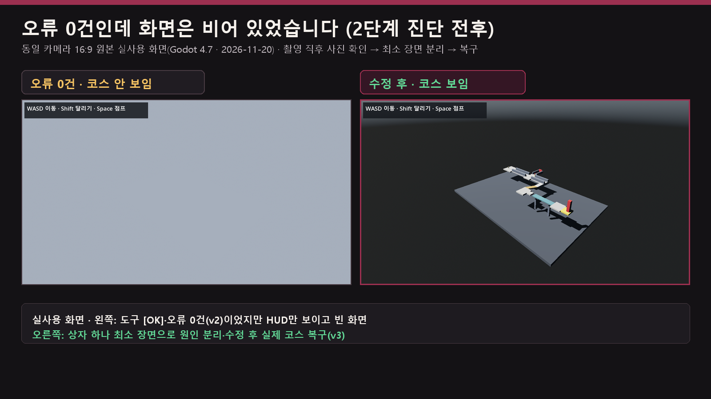

# Godot 로그는 깨끗했는데 왜 화면이 비었을까

2026년 11월 20일, Godot 4.7.2에서 외부 에셋과 애드온 없이 3인칭 이동 코스를 만드는 실험입니다. 평가 기준에는 화면에서 코스가 읽히는지, 이동과 점프가 되는지, 끼이거나 추락하지 않고 도착하는지가 들어 있었습니다. 첫 작업은 2시간 50분, 추가 검증과 보완은 47분이었습니다. [X 타래](https://x.com/Ada_labs_F/status/2124276759546003896)

## 서로 다른 두 문제가 있었다

| 촬영 | 오류 로그 | 실제로 확인된 것 |
| --- | ---: | --- |
| v1 | 3건 | `BoxShape3D size cannot be negative.` 세 곳. 오류가 있었으므로 진단용 화면으로 분류했습니다. |
| v2 | 0건 | 박스를 만드는 `deck()`에 좌표가 거꾸로 들어와도 크기를 올바르게 계산하도록 양 끝을 정렬했습니다. 오류는 사라졌고, 공개한 원경 컷에는 조작 안내만 보였습니다. |
| v3 | 0건 | 주변광과 안개 색을 수정한 뒤, 같은 카메라의 원경에서 코스와 바닥·벽·하늘이 구분됐습니다. |

전후 비교 메모의 v2 행에는 코스가 보였다는 문장도 남아 있습니다. 공개 타래에서 비교한 범위는 원본 `wide` 컷 두 장입니다. 이 범위는 남아 있는 화면과 사진별 보고서로 대조했습니다.

## 무엇을 보고 수정했나

Ada는 1단계에서 만든 3D 진단 스킬을 읽고, 촬영 결과를 열어 확인했습니다. 이전 작업의 11월 19일자 성찰일지에는 첫 렌더를 보지 않은 채 약 50분 동안 설정을 바꿨다고 적혀 있습니다. 이번에는 전체 코스를 계속 수정하는 대신 상자 하나만 둔 최소 장면으로 문제를 좁혔습니다.

v2에서 v3으로 갈 때 주변광 소스를 하늘 배경에서 어두운 고정 색으로 바꿨습니다. 색은 RGB `(0.18, 0.22, 0.28)`, 주변광 강도는 `0.45`였습니다. 안개에 사용할 빛 색도 지정했습니다. 두 설정을 함께 바꿨으므로 각 설정의 기여도는 따로 측정하지 않았습니다.

## 무엇을 다시 확인했나

- v2와 v3에서 메시 27개, 삼각형 3,768개, 장면 경계 상자가 같았습니다.
- 두 `wide` 컷의 카메라 위치는 `(90, 65, 90)`, 시선 목표는 `(0, −6.5, 0)`, 화각은 `60°`로 같았습니다. [v2 원경](../assets/godot-blank-screen-v2.png) · [v3 원경](../assets/godot-blank-screen-v3.png)
- 이후 리뷰어가 입력 검사를 요청했습니다. 최초 검사는 0/4였고, 이동 입력을 수정한 뒤 자동 입력 검사 6/6이 통과했습니다. 후속 확인에서 113.5m 코스를 자동 주행으로 23.50초에 완주했고, 끼임과 추락은 0건이었습니다. 손으로 키보드를 눌러 완주한 기록은 없으며, 입력은 `Input.action_press`를 쓰는 스크립트 경로로 확인했습니다.

2단계에서는 이전 진단 절차를 실제로 다시 쓰는 행동이 관찰됐습니다. 스킬 안내와 사진 자동 첨부도 함께 바뀌었으므로, 어느 변경이 그 행동을 만들었는지는 이 사례 하나로 가를 수 없습니다.
