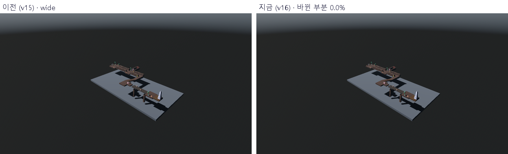

# 3D 작업 다섯 단계에서 무엇을 배웠나

2026년 11월 19–21일, Ada가 Godot과 Blender에서 지형, 이동 코스, 에셋, 직접 만든 소품, 캐릭터 애니메이션을 순서대로 작업했습니다. 각 단계는 다른 과제여서 걸린 시간을 같은 난도의 속도 비교로 사용할 수 없습니다. 아래는 각 단계의 원래 판정서에서 확인한 결과입니다.

실행은 Windows의 Ada 앱 하네스에서 이뤄졌고, Godot 검수는 4.7 계열에서 수행했습니다. 판정서 다섯 편에는 모델 가중치와 엔진 빌드 식별자가 모두 남아 있지 않아 단계별 모델 설정 대조는 미확인입니다. FPS는 측정 환경에 영향을 받았습니다. 예를 들어 5단계의 118.31 FPS와 4단계의 118.55 FPS는 같은 조건에서 잰 값이며, 별도의 헤드리스 144대 수치와 한 비교에 섞지 않았습니다.

| 단계 | 과제와 소요 시간 | 확인한 결과 | 남은 문제·개입 |
| --- | --- | --- | --- |
| 1. 지형 | 기본 3D 장면과 200m×200m 지형, 7시간 45분 | 4장 재촬영, 로그 오류·경고 0, 720p 118.5 FPS, 메시와 충돌 높이 대조 | 경계가 네모 판처럼 보이고 바위가 격자 배치. 첫 렌더는 리뷰어 요청으로 43분 뒤 확인. 조정 5회 |
| 2. 이동 | 그레이박스 코스, 2시간 50분과 보완 47분 | 입력 0/4 → 6/6 및 113.5m 주행, 빈 화면 환경 수정 | 실제 키 경로 검사와 시간 표시 보완은 외부 리뷰에서 지적. [상세](godot-blank-screen.md) |
| 3. 에셋 | Godot으로 외부 에셋 가져오기, 4시간 46분 | 가져오기 277개 최신, 자동 주행 23.50초·입력 6/6. 원본 배율을 변경한 뒤 재가져오고 원래 결과와 대조 | 바닥의 면 감김 실수를 리뷰어가 처음 지적. Ada가 양면 렌더 대조로 원인 확인. 재질 스타일 혼용과 카메라 가림이 남음 |
| 4. 소품 | Blender 소품과 항구 초소, 10시간 1분과 별도 보완 약 7시간 | GLB 12개 검사 통과. 참고 이미지 비교는 처음에 누락돼 보완에서 충족 | 최초 조정 8회, 보완 4회. 기술 통과와 참고 화면 비교를 따로 판정 |
| 5. 캐릭터 이동 | 기성 65본 캐릭터의 걷기·달리기·점프, 9시간 14분 | 걷기 접지 최대 위치 차이 28.12 → 1.58cm. 실제 입력 경로 검사 6/6 | 리뷰어 2회 개입. 달리기의 남은 미끄러짐과 미세한 자세 문제는 별도 관찰. [상세](godot-foot-slide.md) |

이 비교는 3단계에서 에셋 원본을 되돌리고 가져오기 배율을 조정한 뒤, 원경 결과가 같게 나오는지를 확인한 화면입니다. 화면의 0.0%는 이 컷의 변경량입니다.

## 누가 무엇을 바꿨나

사용자가 원한 것은 다음 작업에서 불필요한 실수와 시간을 줄이는 것이었습니다. 외부 리뷰는 단계별 과제와 평가 기준을 만들고, 1단계에서 렌더를 먼저 보도록 유도했습니다. Ada는 최소 장면을 만드는 진단을 스킬로 남겼고 2단계에서 스스로 다시 사용했습니다. 3단계에서는 이전에 기록한 면 감김 검사까지 항상 적용되지는 않았습니다. 이 두 기록이 함께 있으므로 어느 경우에 노하우가 전달되고 어느 경우에 놓치는지 비교할 수 있습니다.
