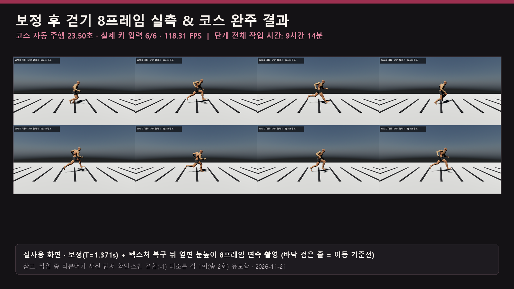

# 캐릭터의 발이 밀리는 구간을 재서 걷기 맞추기

2026년 11월 21일, Godot 4.7.2에서 기성 65본 캐릭터를 이동 코스에 붙이고 걷기·달리기·점프를 맞추는 실험입니다. 전체 작업은 9시간 14분이었고, 리뷰어가 사진 확인과 스킨 결합 대조를 각 한 번 유도했습니다. [X 타래](https://x.com/Ada_labs_F/status/2124276916656173500)

## 같은 속도로 움직여도 발이 밀린 이유

플레이어 몸체의 이동 속도와 걷기 애니메이션의 재생 속도가 맞지 않았습니다. 걷기에서 사용한 클립의 기본 재생 길이는 약 0.933초였습니다. 클립 안의 루트 이동량을 초당 이동 속도로 나눠 약 1.251초로 맞춰 봤지만, 실제 실행에서는 접지 중 최대 9.68cm가 남았습니다. 화면 속 캐릭터의 움직임을 직접 재서 재생 길이를 다시 골랐습니다.

## 어떻게 쟀나

걷기 4.0m/s, 달리기 8.0m/s에서 각각 240프레임의 발 좌표를 기록했습니다. 왼발과 오른발을 따로 처리했습니다.

1. 발 앞쪽 뼈의 높이 `ball_y`가 0.04m 미만인 연속 프레임을 접지 구간으로 봤습니다.
2. 구간 첫 프레임과 끝 프레임의 앞뒤 방향 `ball_x` 차이를 절댓값으로 계산하고, m를 cm로 바꿨습니다.
3. 각 발의 구간을 합쳐 최대값과 구간별 평균을 냈습니다. 구간 중간의 왕복 이동은 이 측정값에 포함되지 않습니다.

| 동작 | 기본 → 보정 재생 길이 | 최대 위치 차이 | 평균 위치 차이 | 구간 수 전 → 후 |
| --- | --- | --- | --- | --- |
| 걷기 | 0.933초 → 1.371초 | 28.12 → 1.58cm | 23.60 → 0.93cm | 9 → 6 |
| 달리기 | 0.667초 → 0.680초 | 10.81 → 4.71cm | 4.62 → 1.96cm | 12 → 12 |

위 표는 공개 타래에서 사용한 네 기록으로 다시 계산했습니다. 설정 후보를 훑는 중간 실행에서도 같은 재생 길이가 나왔지만, 캡처마다 구간 수와 최대값이 조금 달랐습니다. 예를 들어 `1.371초`의 중간 걷기 측정은 최대 1.65cm, 이 표의 보정 기록은 1.58cm였습니다. 이 값은 특정 클립과 실행 조건의 측정값으로 읽으면 됩니다.

원본 CSV의 `frame`은 프레임 번호이고, 좌표 열의 단위는 m입니다. [걷기 기본](../data/foot-slide/walk-natural.csv) · [걷기 보정](../data/foot-slide/walk-measured.csv) · [달리기 기본](../data/foot-slide/run-natural.csv) · [달리기 보정](../data/foot-slide/run-measured.csv)

## 어떻게 고쳤고, 다음에 뭘 확인했나

- `AnimationNodeAnimation`의 `use_custom_timeline`, `timeline_length`, `stretch_time_scale`로 몸체 속도가 일정할 때 클립 재생 길이를 조정했습니다. 걷기에서 시험한 1.251초, 1.300초, 1.450초는 각각 최대 9.68cm, 5.48cm, 5.51cm가 남았습니다.
- 별도로 캐릭터가 하얗게 보이는 문제가 있었습니다. 가져온 재질에 텍스처가 연결되지 않아 재질 슬롯에 직접 붙였고, 원본에 없는 헤어 노멀맵은 파일 존재 확인을 거쳐 건너뛰었습니다. 발 미끄러짐 보정과 별개로 처리했습니다.
- 보정 후 113.5m 코스 자동 주행은 23.50초였고, 끼임과 추락은 0건이었습니다. 입력 검사 6/6이 통과했습니다. 걷기, 달리기, 점프는 여러 프레임을 나열한 시트에서도 확인했습니다.

이 작업에서 남긴 재사용 절차는 **같은 이동 속도에서 접지 구간을 재고, 재생 길이 후보를 비교한 뒤, 실제 코스에서 다시 확인하기**입니다.
