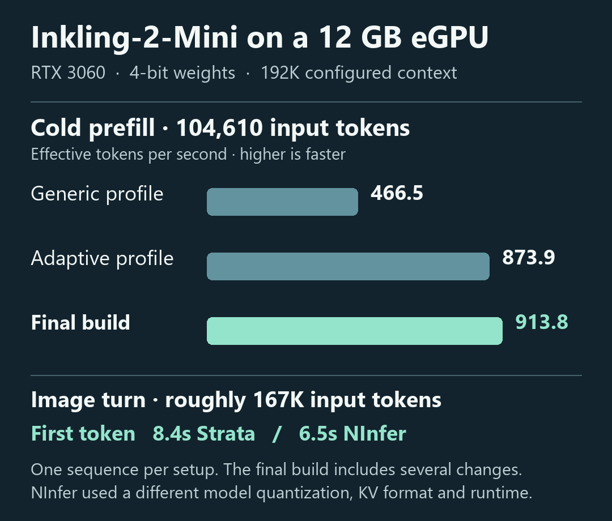

# Inkling-2-Mini on a 12 GB RTX 3060 eGPU

**One 104,610-token prompt went from 224.2 s to 114.5 s before the first streamed token.** This report documents the profile tuning, a separate MoE correctness fix, and how the final configuration compared with NInfer on the same PC.

Tested on November 26, 2026. The engine is based on [`kuraneko1/Strata` at `22ce0b8`](https://github.com/kuraneko1/Strata/commit/22ce0b8), derived from [`Niko1221/Strata`](https://github.com/Niko1221/Strata). The fork distributes its engine code under the [MIT license](https://github.com/kuraneko1/Strata/blob/main/LICENSE).

## Test setup

- Ryzen 7 8840U host with 64 GB RAM and a 12 GB RTX 3060 (`sm_86`) eGPU. The adapter reported a PCIe Gen4 ×4 link.
- Fork runs used Windows 11 and WSL2, with the `UD-Q4_K_M` GGUF, Q8 KV and a 196,608-token limit. The benchmark exercised about 167K input tokens at its largest turn. The final configuration used a Q8 DSpark drafter (`--draft-max 3`) and started the image encoder on demand with a 1,152 MiB reserve.
- The seven requests used `temperature=0.3`, `top_p=0.95` and a 400-token output limit. Each configuration has one recorded sequence. The input used an Ada work-log replay with short follow-ups and one screenshot. Each run used its own generated replies in later turns, so exact context lengths and completion sizes differ. The public CSV omits the private replay text, screenshot and answer excerpts.
- Time to first token (TTFT) is measured at the first streamed reasoning or response chunk. Effective prefill throughput is `(prompt tokens − reported cached tokens) ÷ TTFT`. It includes request overhead. Decode throughput is measured from the first chunk to stream completion. [Per-request measurements](../data/inkling2-rtx3060-egpu.csv)

## Same fork, three configurations

| Metric | Generic profile | 12 GB `sm_89` profile allowed on `sm_86` | Final configuration |
| --- | ---: | ---: | ---: |
| 104.6K cold TTFT | 224.2 s | 119.7 s | **114.5 s** |
| 104.6K effective cold prefill | 466.5 tok/s | 873.9 tok/s | **913.8 tok/s** |
| ~166K extension TTFT, ~61K new tokens | 205.8 s | 115.8 s | **90.5 s** |
| Extension effective prefill | 296.8 tok/s | 527.2 tok/s | **674.9 tok/s** |
| Cached follow-up TTFT near 105K | 1.0–1.1 s | 0.9–1.0 s | 0.8–1.2 s |
| Cached follow-up TTFT near 166K | 1.2–1.7 s | 1.1–1.5 s | 1.1–3.7 s |
| Cached follow-up decode across ~105K–166K | 18.1–25.5 tok/s | 19.9–27.1 tok/s | **25.1–30.9 tok/s** |
| Image TTFT at ~167K | 10.4 s | **8.2 s** | 8.4 s |

The generic profile used conservative prefill settings on `sm_86`. Allowing the fork's existing 12 GB adaptive profile produced most of the observed cold-prefill gain. The final run also changed available VRAM, the vision reserve and the local build. Earlier runs predate the slot synchronization fix, so they are useful performance records of earlier builds. Isolating the effect of each change would require a correctness-fixed ablation under identical conditions.

An earlier adaptive-profile build ran the long-context sequence at `temperature=1.0`. That sequence predates the slot fix and is outside the comparison above. The patched build was exercised at `temperature=1.0` in the separate short generation check.

## Other runtimes on the same PC

| Runtime and test | Cold prefill / TTFT | Extension prefill / TTFT | Cached text decode (~105K–166K) | Image TTFT / decode |
| --- | ---: | ---: | ---: | ---: |
| Patched `strata-inkling2`, WSL2, `UD-Q4_K_M`, Q8 KV | **913.8 tok/s / 114.5 s** | **674.9 tok/s / 90.5 s** | **25.1–30.9 tok/s** | 8.4 s / **22.4 tok/s** |
| NInfer-all `2026-11-25.2`, Windows, `UD-IQ4_XS`, `rk4v4` KV | 431.0 tok/s / 242.8 s | 336.3 tok/s / 181.6 s | 14.1–18.7 tok/s | **6.5 s** / 13.4 tok/s |

These are measurements of the tested configurations. The model quantization, KV format and OS runtime differ. The default NInfer configuration completed all seven requests. An alternate configuration using `--embedding-residency host` was rejected at startup for this model and has no timing result. In the recorded Strata SQ-15 run with [Niko1221/Strata PR #6780](https://github.com/Niko1221/Strata/pull/6780), two short checks completed. No comparable long-context measurements were recorded for that run. Unsloth `llama.cpp b12651` is the same-weight correctness reference below.

For context, a separate earlier Qwen replay on this PC measured 521.6 tok/s cold prefill at 105,577 tokens, 471.7 tok/s on extension to ~164K and 27.1 s image TTFT. Qwen's cached text decode was 29.9–36.4 tok/s and was faster in three of four corresponding follow-ups. This is previous-use context across two different models, with different token counts and runtimes. The earlier Maya tests did not provide a directly comparable seven-step series for this report.

Image TTFT means time to begin streaming. For the final image request, the fork generated 400 tokens in 26.2 s total. NInfer generated 305 tokens in 29.2 s total. The image check exercised the input path and timings. It did not grade visual understanding.

## Correctness fix

On the affected build, the host's expert-slot table showed resident experts in `blk.0` and `blk.1` while the GPU's table still held `-1`. With CPU computation skipped for resident experts and GPU grouping skipping invalid slots, the layer's MoE contribution could become zero. A forward-pass synchronization of the device table recovered the reference first-token ranking in the three cases below. The initial placement or resize path that left the tables inconsistent is still a candidate for a narrower fix.

| Short prompt | Reference top-1 selected before → after | Top-20 overlap vs Unsloth `llama.cpp b12651` |
| --- | --- | --- |
| `ko_open` | No → Yes | 1/20 → 19/20 |
| `en_open` | Yes → Yes | 1/20 → 19/20 |
| `en_mid` | No → Yes | 10/20 → 20/20 |

A separate short generation check recorded answer text in **0/9 before and 7/9 after** the resync build. Two post-resync cases still had empty answer text. The verifier reported `finish_reason=length` for all nine post-resync cases in that run. The three first-token comparisons are the stronger correctness evidence here. They do not establish full-layer numerical parity or broad answer quality.

## Reproduction notes

Report the source commit and selected patch hunks, GPU link width and generation, backend, model artifact and KV format, settings for DSpark and vision, free VRAM before launch, and the number of repeats. For a controlled runtime comparison, use identical public requests and replay fixed assistant replies, so the same text, image and cache transitions reach every engine. The CSV preserves all seven rows for each of the four Inkling configurations in the comparison, including uncached token counts, completion lengths and sampled GPU memory.
