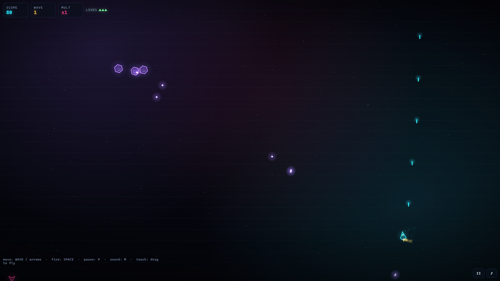

# 같은 Neon Blaster 과제의 결과물 다섯 개를 실행해 봤다

2026년 11월 18일 독립 평가입니다. 공통 과제는 웨이브·보스·강화 아이템·화면 흔들림·합성음이 있는 우주 슈팅 게임이었습니다. 사용자 요청으로 Ada의 완성작과 공개 결과물 네 개를 모았고, Codex가 원본을 대조하고 실제 입력으로 실행했습니다. [공개 과제와 원본](https://goldiebench.com/tasks/neonblaster)

## 제작 조건과 확인된 차이

| 후보 | 제작 하네스·모델 | 제작 시간 / 토큰 | 잠정 점수 /100 | 실제 플레이 캡처 |
| --- | --- | --- | ---: | --- |
| MiMo-V2.6 Pro | 공개 Agent OS 계열, 3D Three.js 결과물. 해당 실행의 양자화·개별 호출 기록 미공개 | 미공개 | 84 | [MiMo 화면](../assets/neon-blaster/mimo.png) |
| Fusion | 공개 다중 모델 구성, 잘린 결과를 24K 예산으로 재시도한 기록. 모델별 기여와 실제 토큰 미공개 | 미공개 | 81 | [Fusion 화면](../assets/neon-blaster/fusion.png) |
| Ada | Ada 앱 하네스, 로컬 Qwen3.8-Flash-Next Q2_0. 기존 게임 검사 스킬 재사용, 반복 개발 | 87분 21초 / 메인 요청 174회 | 77 | [Ada 화면](../assets/neon-blaster/ada.png) |
| GPT-5.6 Sol | 공개 Agent OS 계열, 해당 실행의 양자화·호출 기록 미공개 | 미공개 | 77 | [Sol 화면](../assets/neon-blaster/sol.png) |
| Claude Fable 5 | 공개 Agent OS 계열, 해당 실행의 양자화·호출 기록 미공개 | 미공개 | 67 | [Fable 화면](../assets/neon-blaster/fable.png) |

Ada의 메인 모델 집계는 입력 20,737,191토큰(캐시 재전송 포함), 캐시 입력 20,313,164, 새 입력 424,027, 출력 141,311입니다. 추론과 비전의 별도 사용량은 미확인입니다. 24K는 Fusion의 재시도 예산이고 관측 토큰은 공개돼 있지 않습니다. 다섯 후보에 대한 제작 속도·토큰 효율 순위는 계산할 수 없습니다.

## 어떻게 시험했고 어디에서 막혔나

- 평가자는 같은 Windows PC의 Chromium 151에서 1920×1080, DPR 1로 정상 입력을 사용해 각 후보를 최소 세 번 플레이했습니다. 모바일은 390×844 브라우저 에뮬레이션입니다. 점수·체력·시간·웨이브를 바꾸지 않았습니다.
- MiMo는 wave 4 보스, Fusion은 wave 5 보스를 관측했습니다. Ada는 이동·발사·웨이브·재시작이 작동했습니다. 보스와 모든 강화 아이템은 독립 플레이에서 확인하지 못했습니다.
- Ada의 게임오버 카드에는 1,765점, HUD에는 1,855점이 남는 결함이 재현됐습니다. 재시작은 점수 0·wave 1·목숨 3으로 돌아왔습니다. 점수 차이의 코드 원인은 확인하지 않았으며 이 배포본에는 수정이 들어가지 않았습니다.
- 시각 30·플레이 25·콘텐츠 15·연출 15·기술 10·사운드 5 기준입니다. 사운드의 기술 확인 3점만 반영했고, 스피커에서 판단하는 믹스와 음악성 2점은 미평가입니다. 같은 과제의 최종 결과물에 대한 한 평가자의 점수입니다.

## Ada 원본 실행하기

[Neon Blaster 단일 HTML](../artifacts/neon-blaster.html)을 다운로드해 브라우저에서 열면 오프라인에서 실행됩니다. WASD나 방향키로 움직이고, 스페이스바로 발사할 수 있습니다. [공개 후보 실행 링크](https://goldiebench.com/best-for/neonblaster)

보관된 Ada HTML과 당시 독립 평가에 사용한 원본의 SHA-256은 `e56c3e572fc28333c24c59fcc4d07f8addf3707822303aad6b289fe350cdd84a`로 일치합니다. 모델별 캡처는 각 원본을 실행한 첫 시도의 초반 전투 화면입니다. 난도와 적 배치는 실행마다 달라질 수 있습니다.
